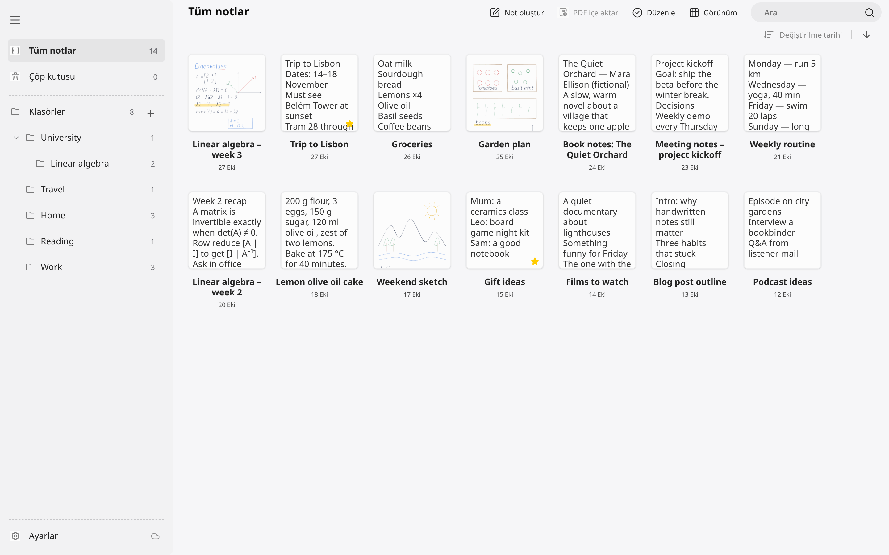
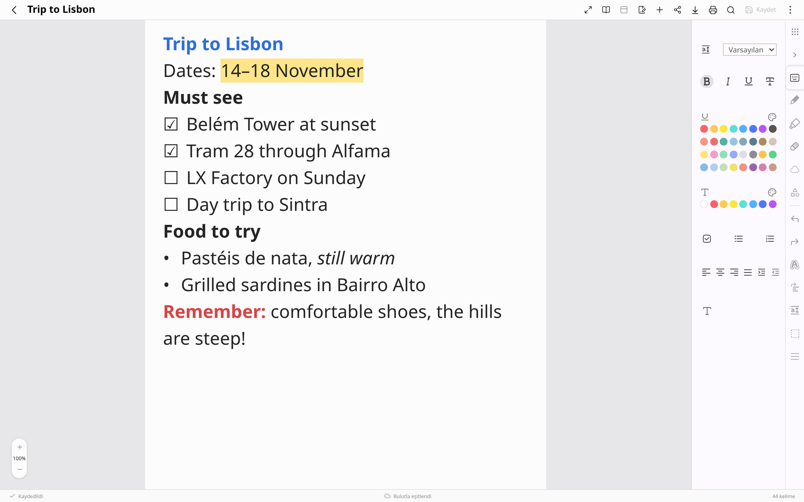
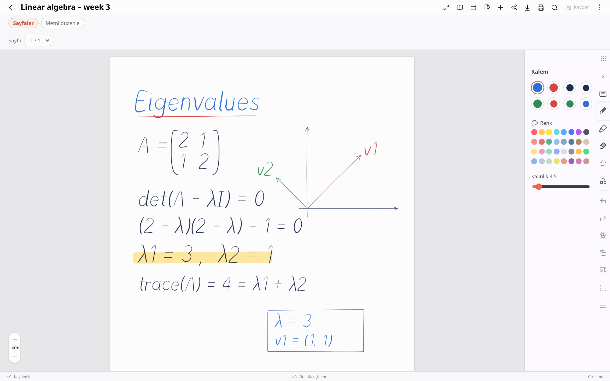
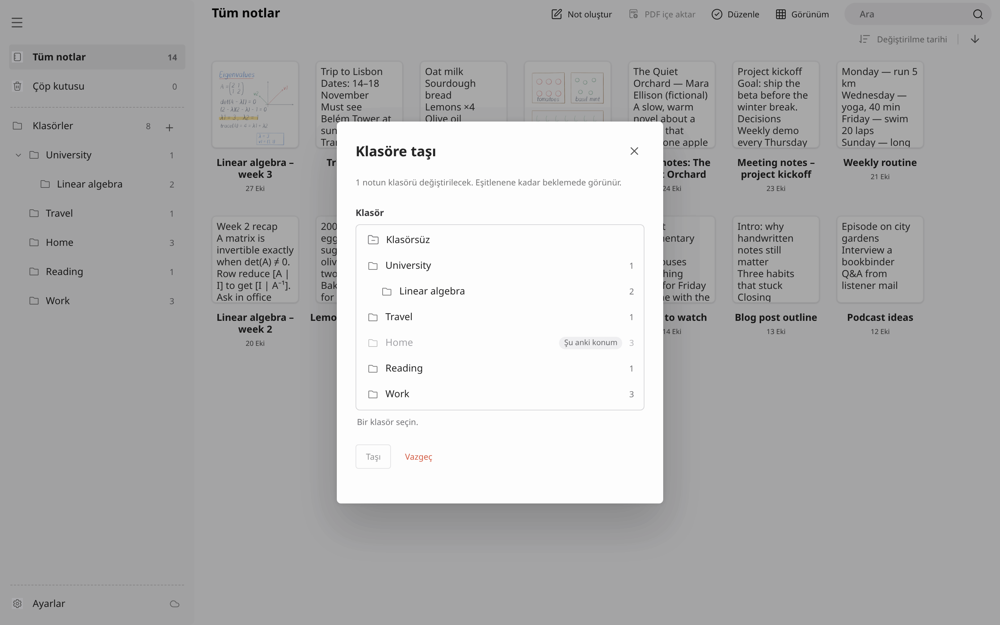
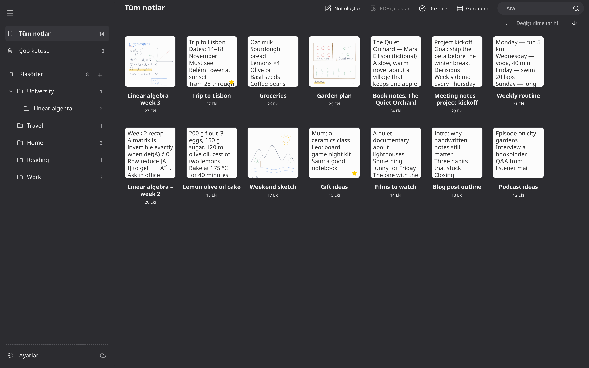
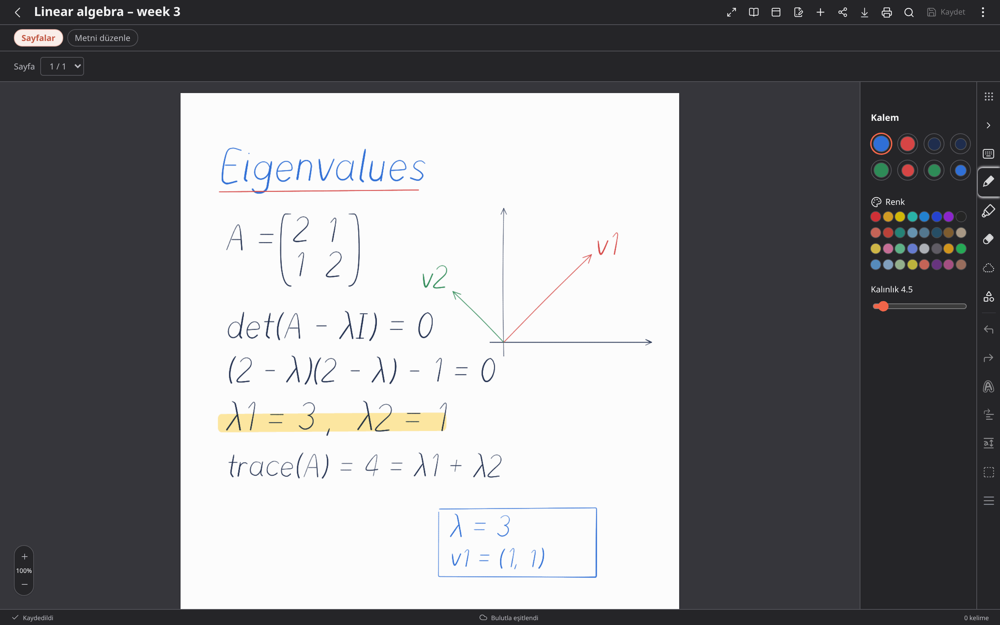

# Notes

[](https://github.com/Tunahanyrd/notes/actions/workflows/ci.yml)
[](https://github.com/Tunahanyrd/notes/releases)
[](LICENSE)

Samsung Notes compatible · unofficial

An unofficial desktop client for Linux, compatible with Samsung Notes. It
signs in with a Samsung account, syncs notes with Samsung Cloud and lets you
read and edit them in a native window — no Wine, Windows VM or Android
emulator involved. A macOS build exists but has not yet been tested on a Mac.

> **Alpha software.** Releases are
> [pre-releases](https://github.com/Tunahanyrd/notes/releases).
> Every Cloud write is checked by reading the note back, but keep backups of
> notes that matter and expect rough edges. The user interface is in Turkish.

## Screenshots

| | |
|---|---|
|  |  |
|  |  |
|  |  |

<sub>Screenshots use an invented demo library (`desktop/tests/fixtures/demo-library`); regenerate with `node tools/screenshots.mjs`. The UI is shown in Turkish.</sub>

## Disclaimer

This is an independent, unofficial project. It is not affiliated with,
endorsed by, or sponsored by Samsung Electronics Co., Ltd. "Samsung",
"Samsung Notes" and "Galaxy" are trademarks of Samsung Electronics Co., Ltd.,
used here only to describe compatibility.

This client was implemented independently to interoperate with Samsung Notes. The file formats and protocol were documented through interoperability analysis (network observation, file inspection and static analysis of the official clients); the project contains no Samsung code, binaries or assets. Third-party open-source code that the project
uses — for example the GPL-3.0 [sdocx](https://github.com/twangodev/sdocx)
renderer library — is not Samsung code and is attributed in [NOTICE](NOTICE).

The client talks to Samsung's private, undocumented services. They can change
at any time and break the client without notice, and using a third-party
client may not be permitted by the terms of the service you connect to. You
are solely responsible for how you use this software and for complying with
the terms of any third-party service, including Samsung's. Every Cloud write
is verified by reading the whole note back, but data loss is still possible;
keep backups of notes that matter.

The software is provided "as is", without warranty of any kind, as stated in
sections 15 and 16 of the GNU General Public License v3. The authors are not
liable for account actions, data loss or any other consequences of its use.
Details: [docs/LEGAL.md](docs/LEGAL.md).

## Status

Features are listed with the strongest evidence that exists for them.
"Cloud-verified" means a controlled write to a dedicated test note was
accepted by Samsung Cloud and confirmed by a full readback; "seen on device"
means the result was also checked in the official app on a phone or tablet.
"Offline" means it was checked against synthetic notes or a local copy of a
library without writing to Samsung Cloud. One level does not imply the next.

| Feature | Evidence |
|---|---|
| Browser sign-in (Samsung account) and session reuse | Live with the Rust sign-in code; a fresh sign-in through the packaged `notes-engine` binary has not yet been observed live |
| Download sync into a local SQLite library, offline reading | Live |
| Plain-text notes: create, edit, upload | Cloud-verified, seen on device |
| Rich text (bold, italic, colour, alignment) | Cloud-verified, seen on device (limited set of styles) |
| Text and rich-text editing in notes that also contain handwriting, and in notes whose text has a picture inserted on a phone (the picture anchor is kept, not editable) | Cloud-verified (test notes) |
| Title edits that preserve ink and body | Cloud-verified |
| Favorites, trash/restore, folders (create, rename, move, trash empty folder) | Cloud-verified |
| Ink: add strokes (colour and thickness), first stroke on an empty page, eraser, lasso move | Cloud-verified, seen on device |
| Ink on PDF pages | Cloud-verified, seen on device |
| Ink on notes that contain pictures, shapes, text boxes or pictures placed freely on the page (those objects are carried over byte for byte) | Cloud-verified, seen on device (one test note) |
| Highlighter | Cloud-verified, seen on device |
| Shapes: add rectangle, ellipse, triangle, right triangle, diamond, line, arrow (colour, thickness, fill) | Cloud-verified, seen on device for a rectangle and a line; other kinds offline tests only |
| Page background colour, add / move / delete pages, insert PDF, templates | Cloud-verified, seen on device |
| Page previews for every page type (handwriting, PDF, pictures, shapes, text boxes) and card thumbnails, rendered in sandboxed helper processes | Offline; pictures, shapes and text boxes are drawn by this client and are close to, not identical with, the official renderer |
| Save as file (PDF from page images, or plain text) to the Downloads folder | Offline |
| Token renewal | Implemented and tested against recorded exchanges; not yet observed live |
| macOS (.dmg) | Built and self-checked in CI; never run on a Mac |

Not supported (for now):

- permanent delete, and moving a folder that still contains notes to the trash;
- locked/encrypted notes;
- editing, moving or deleting existing shapes, converting strokes to shapes,
  and creating new pen presets;
- duplicating handwritten notes or notes with a picture in their text
  ("Share" copies the note text to the clipboard only);
- audio and other attachment types the client does not recognise — such notes
  are kept read-only instead of being flattened to plain text.

The live pen preview and the page previews are drawn by the client; they are
not pixel-identical to the official renderer.

## Install

Download the package for your system and `SHA256SUMS` from the
[latest release](https://github.com/Tunahanyrd/notes/releases) (pre-releases are
alphas) into one directory and check them first:

```sh
sha256sum -c --ignore-missing SHA256SUMS
```

| Package | Install |
|---|---|
| Arch Linux | `sudo pacman -U ./notes-*.pkg.tar.zst` |
| AppImage (any x86_64 distribution) | `chmod +x Notes_*_amd64.AppImage && ./Notes_*_amd64.AppImage` |
| Debian / Ubuntu | `sudo apt install ./Notes_*_amd64.deb` |
| Fedora / openSUSE / RHEL | `sudo dnf install ./Notes-*.x86_64.rpm` |
| Flatpak | `flatpak install --user io.github.tunahanyrd.Notes-*.flatpak` |

The Flatpak bundle needs the GNOME 50 runtime from Flathub; if it is missing,
add Flathub first:
`flatpak remote-add --user --if-not-exists flathub https://dl.flathub.org/repo/flathub.flatpakrepo`.
The Arch, .deb and .rpm packages pull in poppler, bubblewrap and xdg-utils;
ImageMagick is recommended (PDF export). The AppImage expects `pdftoppm`/`pdfinfo`
(poppler) and `bwrap` (bubblewrap) on the host for page previews, and does not
add itself to the application menu (use your desktop's AppImage integration,
e.g. Gear Lever or AppImageLauncher).

**macOS** (`Notes-*-arm64.dmg` for Apple silicon,
`Notes-*-x86_64.dmg` for Intel): the disk image is **unsigned and
not notarized** and has not yet been tested on a real Mac. Check it against
`SHA256SUMS` (or its `.sha256` file), drag the app to Applications, then
right-click it → **Open** (or run
`xattr -dr com.apple.quarantine /Applications/Notes.app`). Poppler, librsvg
and ImageMagick are optional runtime tools:
`brew install poppler librsvg imagemagick`. Details:
[docs/MACOS_PORT.md](docs/MACOS_PORT.md).

## Privacy

- **No telemetry.** The client sends no analytics or crash reports. Network
  traffic goes to Samsung's account and Samsung Cloud services (and the
  signed download links Samsung Cloud returns); the UI itself may only talk
  to the local engine on 127.0.0.1.
- **Everything stays on your machine.** On Linux the note library (SQLite,
  outbox, preview cache) lives in `$XDG_STATE_HOME/samsung-notes-linux`
  (default `~/.local/state/samsung-notes-linux`), and sign-in sessions and
  Samsung tokens in `$XDG_STATE_HOME/samsung-notes-research`, written with
  owner-only permissions (0600 files, 0700 directories). Inside Flatpak the
  same paths are under `~/.var/app/io.github.tunahanyrd.Notes/`. On macOS
  both live in `~/Library/Application Support/org.linuxnotes.desktop`.
  Temporary runtime files go to `$XDG_RUNTIME_DIR/samsung-notes-linux`.
  "Save as file" writes to your Downloads folder.
- **Tokens never reach the UI.** The window talks to the engine over loopback
  HTTP with a per-launch bearer token; Samsung tokens, signed URLs and raw note
  files stay inside the engine.
- **Sign-in callback.** Outside Flatpak (which ships its own handler), the
  first sign-in on Linux registers a desktop entry for the `ms-app` URL scheme
  under `$XDG_DATA_HOME/applications` and makes it the default in
  `mimeapps.list`, after saving a copy of the previous file. It refuses to
  replace a different existing `ms-app` handler.

## Build from source

Requirements: Rust (stable, 1.95+), Node.js 22+, Python 3 (standard library
only, for helper scripts such as the conformance harness and branding/license
checks — the application itself contains no Python), and the Tauri 2 system
libraries (webkit2gtk-4.1, gtk3,
libsoup3). Runtime tools used by previews and export: `pdfinfo`/`pdftoppm`
(poppler-utils), `rsvg-convert` (librsvg), `magick` (ImageMagick) and
`bwrap` (bubblewrap; optional inside Flatpak/macOS, where a reduced sandbox is
used).

```sh
# 1. Fetch the GPL-3.0 renderer library at the pinned commit
tools/fetch_sdocx.sh

# 2. Engine and renderer
cargo build --release -p notes-engine
cargo build --release --manifest-path tools/ink-renderer/Cargo.toml

# 3. Live pen preview (optional; needs `rustup target add wasm32-unknown-unknown`;
#    without it the UI keeps a simpler preview), then the frontend
tools/build_ink_wasm.sh
(cd desktop && npm ci && npm run build)

# 4. Desktop shell; on Linux it starts the notes-engine binary from step 2
#    (LINUX_NOTES_ENGINE=embedded with --features embedded-engine runs it in-process)
cargo run --release --manifest-path desktop/src-tauri/Cargo.toml
```

The engine is pure Rust (`crates/notes-*` on top of the plain-Rust area
cores in `crates/rs-*`). An earlier implementation served as the behavioural
reference while the engine was written; its responses are frozen as golden
fixtures in `crates/notes-engine/conformance/golden/`, which every change is
checked against.

The engine can also run on its own and serve the UI in a browser:

```sh
target/release/notes-engine --data-dir /tmp/notes-demo --offline --port 0 \
    --runtime-file /tmp/notes-demo/runtime.json --frontend-dir desktop/dist
```

A container with every build and test dependency is described in
[docs/DOCKER.md](docs/DOCKER.md). Packages are built by the scripts in
[`packaging/`](packaging/): [`build-linux-bundles.sh`](packaging/build-linux-bundles.sh)
(AppImage, .deb, .rpm via the Tauri bundler) and
[`build-flatpak.sh`](packaging/build-flatpak.sh) (Flatpak bundle from
`packaging/flatpak/`).

## Tests

See [CONTRIBUTING.md](CONTRIBUTING.md). In short: `cargo test --workspace`,
the notes-engine HTTP conformance replay against frozen golden fixtures (must
stay at 100 %) and the desktop type check + Playwright suite. CI runs all of
them on every pull request (`.github/workflows/ci.yml`).

```sh
cargo test --workspace
cargo build -p notes-engine && python3 crates/notes-engine/conformance/run.py --replay --candidate target/debug/notes-engine
(cd desktop && npx tsc --noEmit && npm run build && npx playwright test)
```

## Documentation

- [docs/ARCHITECTURE.md](docs/ARCHITECTURE.md) — components, crates, data flow
- [CONTRIBUTING.md](CONTRIBUTING.md) — build, tests, write-safety and privacy rules
- [CHANGELOG.md](CHANGELOG.md) — release notes
- [docs/APP_CONTRACT.md](docs/APP_CONTRACT.md) — local engine HTTP API
- [docs/CLIENT_PROTOCOL.md](docs/CLIENT_PROTOCOL.md), [docs/PKCE.md](docs/PKCE.md) — Cloud protocol and sign-in pieces
- [docs/EDITOR_FORMAT.md](docs/EDITOR_FORMAT.md) — rich text format
- [docs/INK_EDITOR.md](docs/INK_EDITOR.md), [docs/INK_CAPTURE_V2.md](docs/INK_CAPTURE_V2.md),
  [docs/INK_APPLICATION.md](docs/INK_APPLICATION.md), [docs/INK_PROJECTION.md](docs/INK_PROJECTION.md) — ink format, writing and outbox
- [docs/CANVAS_CACHE.md](docs/CANVAS_CACHE.md) — page canvas cache decoder
- [docs/WINDOWS_PARITY.md](docs/WINDOWS_PARITY.md), [docs/WINDOWS_SHORTCUTS.md](docs/WINDOWS_SHORTCUTS.md) — UI behaviour and keyboard shortcuts
- [docs/MACOS_PORT.md](docs/MACOS_PORT.md), [docs/DOCKER.md](docs/DOCKER.md), [packaging/VERIFICATION.md](packaging/VERIFICATION.md) — macOS, container and packaging
- [docs/FUZZING.md](docs/FUZZING.md) — fuzz targets
- [docs/LEGAL.md](docs/LEGAL.md), [SECURITY.md](SECURITY.md) — legal notes and reporting vulnerabilities

## Branding

The product name ("Notes"), application id (`io.github.tunahanyrd.Notes`),
binary name and repository URL live only in [`branding.json`](branding.json).
After changing them run

```sh
python3 tools/branding.py sync
```

which regenerates the packaging files (Flatpak manifest, desktop entry,
metainfo). CI fails if they are out of sync.

## License

Our code is GPL-3.0-or-later (see [LICENSE](LICENSE)). The ink renderer
(`ink-render`) and the live pen preview (`notes-ink-live`) link the
GPL-3.0-only sdocx library, so those two binaries are GPL-3.0-only as a
whole; attribution and third-party licenses are listed in
[NOTICE](NOTICE) and the generated third-party license file.
